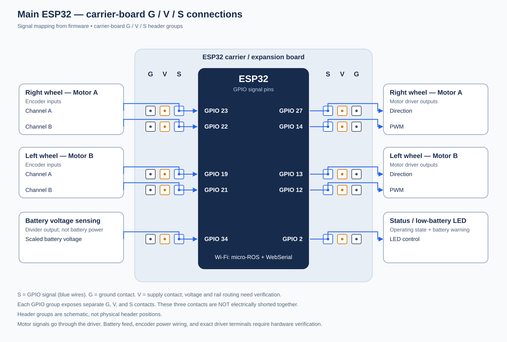

# Main ESP32 input/output pin mapping

Repository review date: 2026-10-19.



[Open the diagram as an SVG](main_esp32_pin_diagram.svg) for printing or inclusion in the submission.

## Carrier-board headers observed in the photo

The supplied hardware photo shows the ESP32 mounted on a carrier/expansion board with header groups labelled **G / V / S**. These expose separate ground, supply, and signal contacts for a GPIO group. They are not three copies of the GPIO and must not be treated as electrically shorted together. The updated diagram shows these groups schematically; its positions do not reproduce the physical header ordering. Only S is connected to the firmware-mapped signal in the drawing. The photo does not verify the voltage of V, rail routing, hidden traces, or every attached G/V wire. Those details still require hardware verification.

This mapping describes the robot-base ESP32 selected by the root `platformio.ini` (`board = esp32dev`). That build compiles `robot/robot_base/platformio_main.cpp`, which includes `robot_base.ino`. GPIO numbers below are ESP32 GPIO identifiers, not physical header positions.

## Assigned GPIOs

Direction is relative to the ESP32. Motor A drives the **right wheel**; Motor B drives the **left wheel**, as recorded in the calibration log and configured by `MOTOR_A_IS_LEFT = false`.

| ESP32 GPIO | Direction | Connected subsystem / signal | Firmware constant | Purpose |
| --- | --- | --- | --- | --- |
| 27 | Output, digital | Right motor (Motor A), driver direction signal | `MOTOR_A_DIRECTION_PIN` | Selects motor drive direction. |
| 14 | Output, PWM | Right motor (Motor A), driver PWM signal | `MOTOR_A_PWM_PIN` | Controls motor drive using `analogWrite()`. |
| 13 | Output, digital | Left motor (Motor B), driver direction signal | `MOTOR_B_DIRECTION_PIN` | Selects motor drive direction. |
| 12 | Output, PWM | Left motor (Motor B), driver PWM signal | `MOTOR_B_PWM_PIN` | Controls motor drive using `analogWrite()`. |
| 23 | Input, digital | Right motor encoder, channel A | `MOT_A_ENCODER_A` | Quadrature encoder feedback. |
| 22 | Input, digital | Right motor encoder, channel B | `MOT_A_ENCODER_B` | Quadrature encoder feedback. |
| 19 | Input, digital | Left motor encoder, channel A | `MOT_B_ENCODER_A` | Quadrature encoder feedback. |
| 21 | Input, digital | Left motor encoder, channel B | `MOT_B_ENCODER_B` | Quadrature encoder feedback. |
| 34 | Input, analog | Battery voltage sensing, scaled voltage-divider output | `BATTERY_PIN` | Measures battery voltage using `analogRead()`. This is the sensing connection, not the battery power feed. |
| 2 | Output, digital | Status / low-battery LED | `LOW_BATTERY_LED_PIN` | Shows operating state, including critical battery, faults, self-test, and agent connection. |

Total: **10 explicitly assigned application GPIOs: 5 inputs and 5 outputs**, including two PWM outputs.

The motor signals go to the motor driver. The driver is an **L293D** (confirmed by the team), but the repository does not provide its physical terminal or IC pin mapping. The direction/PWM names above reproduce the firmware interface; they do not establish which L293D input or enable terminal each wire reaches.

Both encoders use `attachFullQuad()` with internal weak pull-ups requested in setup. A positive raw motor command moved both wheels backward in the recorded calibration; the current firmware compensates with `LEFT_DIR_SIGN = -1.0` and `RIGHT_DIR_SIGN = -1.0`.

## Battery measurement and LED

The firmware estimates battery voltage as:

```text
V_battery = (analogRead(GPIO34) / 4095.0) × 3.3 × 2.8
```

The battery is a **2S Li-ion/LiPo** pack (7.4 V nominal, 8.4 V full). The configured low-battery threshold is **6.6 V**, i.e. 3.3 V per cell. The separate `battery VBAT factor.txt` note reports a measured sensing ratio of `0.356 × actual battery voltage`, approximately consistent with the firmware's inverse factor of 2.8. That note also contains unexplained values of 3 V and 1.18 V; their measurement points are unspecified, so they should not replace the firmware threshold in the submission.

GPIO 2 is shared among status indications. It is not exclusively a low-battery indicator in the current firmware: triple blink indicates fault, double blink critical battery, fast blink self-test, slow blink no agent, and solid on normal connected operation. Fault has the highest indication priority.

## Communication and power connections

The firmware uses Wi-Fi for micro-ROS and WebSerial, with no external communication GPIOs explicitly assigned for those connections. It also starts `Serial` at 115200 baud without explicitly selecting TX/RX pins. The exact board UART/USB wiring therefore needs the board pinout or hardware inspection before it can be listed as a verified physical connection.

The repository does not establish the battery-to-board power route, regulator connections, encoder supply connections, motor power terminals, ground wiring, voltage-divider resistor values, or physical header numbering. These physical connections need hardware verification to complete a full wiring diagram. Other GPIOs are not explicitly assigned by this application; this does not establish that they are available or physically unconnected.

## Repository evidence

- [Active build configuration](../platformio.ini): selects the robot-base source directory, ESP32 board target, and build entry point.
- [Build entry point](../robot/robot_base/platformio_main.cpp): includes the active Arduino sketch.
- [Current pin constants and wheel mapping](../robot/robot_base/robot_hardware.h): GPIO assignments, battery conversion, threshold, and motor side configuration.
- [Current firmware](../robot/robot_base/robot_base.ino): `motors()`, `measure_battery()`, and `setup()` confirm how the pins are used.
- [LED implementation](../robot/robot_base/status_led.h): status patterns and priority.
- [Recorded calibration](../robot/docs/calibration_log_1.md): motor identity/direction table confirms A=right and B=left.
- [Calibration sketch](../robot/robot_calibration/robot_calibration.ino) and the [hardware tests](../unit_tests/hardware/): use the same ten GPIO assignments.
- [Battery sensing note](../robot/battery%20VBAT%20factor.txt): measured voltage scaling.
